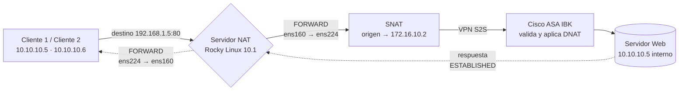

<div align="center">

```
  10.10.10.5 ──┐
               ├──►  [ NAT · Rocky Linux 10.1 · iptables ]  ══ VPN S2S ══►  192.168.1.5
  10.10.10.6 ──┘          SNAT → 172.16.10.2
```

# 🔀 Servidor NAT con Rocky Linux 10.1

### Solución al problema de *Overlapping* en una VPN Site-to-Site usando iptables

*Proyecto académico — Arquitectura de Computadores y Sistemas Operativos · UPC · TB2 · Grupo 3*

<br/>


[Ver script de configuración](https://github.com/PrintToCode/NAT-Server-Rocky-Linux/blob/main/nat_server.sh) · [Reportar un problema](https://github.com/PrintToCode/NAT-Server-Rocky-Linux/issues)

</div>

<br/>

## 📌 Tabla de contenido

- [🌐 Sobre el proyecto](#-sobre-el-proyecto)
- [🎯 Situación problemática](#-situación-problemática)
- [✨ Funcionalidades](#-funcionalidades)
- [🧩 Componentes de la solución](#-componentes-de-la-solución)
- [📐 Arquitectura y topología de red](#-arquitectura-y-topología-de-red)
- [🔧 Tecnologías utilizadas](#-tecnologías-utilizadas)
- [🚀 Instalación y despliegue](#-instalación-y-despliegue)
- [🔀 Flujo del tráfico](#-flujo-del-tráfico)
- [🔐 Reglas de red y seguridad destacadas](#-reglas-de-red-y-seguridad-destacadas)
- [📂 Estructura del script](#-estructura-del-script)
- [🧭 Roadmap](#-roadmap)
- [👥 Equipo de desarrollo](#-equipo-de-desarrollo)
- [📄 Licencia y contexto académico](#-licencia-y-contexto-académico)

<br/>

## 🌐 Sobre el proyecto

Dos empresas —**Inteligo (ITLG)** e **Interbank (IBK)**— están conectadas mediante una **VPN Site-to-Site** y comparten servicios para sus operaciones. IBK incorporó un nuevo **servidor web**, pero ambas sedes usan el **mismo segmento de red local (`10.10.10.0/24`)**, lo que genera un conflicto de direccionamiento conocido como **overlapping** (solapamiento de IP): los paquetes no pueden enrutarse correctamente y los usuarios de ITLG no logran acceder al servicio.

**Servidor NAT con Rocky Linux** es la solución propuesta: una máquina virtual con **Rocky Linux 10.1** que actúa como traductor de direcciones (**SNAT** con **iptables**), enmascarando la IP de origen de los clientes antes de que el tráfico entre al túnel VPN, y funcionando como un router *stateful* que protege la red LAN.

> 💡 Este proyecto forma parte del Trabajo Bibliográfico 2 (TB2) del curso **Arquitectura de Computadores y Sistemas Operativos** (Programa Académico de EPE, Facultad de Ingeniería de Sistemas — UPC).

### Impacto de la solución

| Dimensión | Aporte |
|---|---|
| 💰 **Económico** | Software de código abierto: sin costos de licenciamiento |
| 🌱 **Ambiental** | Entornos virtualizados: menor consumo energético y de hardware físico |
| 🤝 **Social** | Mayor seguridad de la información y confianza en los sistemas de la organización |

<br/>

## 🎯 Situación problemática

| ❌ Antes (con overlapping) | ✅ Ahora (Servidor NAT) |
|---|---|
| Ambas sedes usan `10.10.10.0/24` y los paquetes no se enrutan | El origen de los clientes se enmascara como `172.16.10.2` mediante SNAT |
| Cliente 1 (Windows 11) y Cliente 2 (Linux Mint) sin acceso a `http://192.168.1.5` | Ambos clientes acceden correctamente al servicio web |
| Riesgo de exponer tráfico sin protección adecuada | Router *stateful*: solo se aceptan respuestas de conexiones iniciadas desde la LAN |
| Difícil integrar nuevas sedes o servicios | Solución estable, escalable y de bajo costo |
| Dependencia de licencias comerciales | Rocky Linux gratuito, compatible con el ecosistema RHEL |

<br/>

## ✨ Funcionalidades

<table>
<tr>
<td width="50%" valign="top">

### 🔀 Red y traducción de direcciones
- SNAT con la tabla `POSTROUTING` de iptables
- Enmascaramiento de `10.10.10.0/24` hacia `172.16.10.2`
- Filtro por destino (`192.168.1.5`) y puerto (`TCP 80`)
- IP Forwarding habilitado de forma permanente
- Interfaces LAN y VPN configuradas con `nmcli`
- Acceso remoto por SSH para administración

</td>
<td width="50%" valign="top">

### 🛡️ Seguridad y operación
- Cuenta `root` deshabilitada; administración con usuario `admin` (grupo `wheel`)
- Reglas `FORWARD` con módulo de estados (`RELATED,ESTABLISHED`)
- `firewalld` desactivado para evitar conflictos con iptables
- Reglas persistentes en `/etc/sysconfig/iptables`
- Compatible con clientes Windows y Linux
- Pruebas de conectividad y validación final documentadas

</td>
</tr>
</table>

<br/>

## 🧩 Componentes de la solución

```
FASE 1 · VIRTUALIZACIÓN (VMware Workstation)
 ├── 1. Crear la VM "NATServer" (2 vCPU · 3 GB RAM · 20 GB disco)
 ├── 2. Adaptador de red 1 → LAN1 (Solo host)
 └── 3. Adaptador de red 2 → LAN2

FASE 2 · SISTEMA OPERATIVO
 ├── 4. Instalar Rocky Linux 10.1 (minimal)
 └── 5. Crear usuario "admin" (wheel) · root deshabilitado
       │
       ▼
FASE 3 · RED
 ├── 6. Interfaz LAN  ens160 → 10.10.10.1/24
 └── 7. Interfaz VPN  ens224 → 172.16.10.2/24 (gw 172.16.10.1)

FASE 4 · ENRUTAMIENTO Y FIREWALL
 ├── 8. Activar IP Forwarding
 ├── 9. Instalar iptables-services y desactivar firewalld
 ├── 10. Configurar SNAT y reglas FORWARD
 └── 11. Guardar reglas y validar desde los clientes
```

| # | Fase | Descripción breve | Comando clave |
|---|---|---|---|
| 1 | **Virtualización** | Crea la VM con dos adaptadores de red (LAN1 y LAN2) | VMware Workstation |
| 2 | **Instalación** | Instala Rocky Linux 10.1 con usuario administrador y `root` deshabilitado | Instalador Anaconda |
| 3 | **Interfaces de red** | Asigna IP estática a la LAN y a la interfaz hacia la VPN | `nmcli con mod` |
| 4 | **IP Forwarding** | Permite que el servidor reenvíe paquetes entre interfaces | `sysctl -p` |
| 5 | **iptables** | Instala el servicio y desactiva el firewall local | `dnf install iptables-services` |
| 6 | **SNAT** | Enmascara el origen de los clientes hacia la interfaz VPN | `iptables -t nat -A POSTROUTING` |
| 7 | **FORWARD** | Router *stateful*: LAN → VPN libre, VPN → LAN solo respuestas | `iptables -I FORWARD` |
| 8 | **Persistencia** | Guarda las reglas para que sobrevivan al reinicio | `service iptables save` |
| 9 | **Validación** | Verifica el acceso web desde Windows 11 y Linux Mint | `ping` · navegador |

<br/>

## 📐 Arquitectura y topología de red

```
 ┌──────────── EMPRESA A · INTELIGO ────────────┐          ┌──────── EMPRESA B · INTERBANK ────────┐
 │                                              │          │                                       │
 │  Cliente 1 · Windows 11   10.10.10.5/24 ──┐  │          │                                       │
 │                                           ├──┼─ ens160 ─┤                                       │
 │  Cliente 2 · Linux Mint   10.10.10.6/24 ──┘  │ 10.10.10.1                                       │
 │                                              │          │                                       │
 │            [ Servidor NAT · Rocky Linux 10.1 ]          │   Cisco ASA IBK ──► Servidor Web      │
 │                      ens224 · 172.16.10.2 ═══ VPN S2S ═══►  (VNG 172.16.10.1)   192.168.1.5     │
 └──────────────────────────────────────────────┘          └───────────────────────────────────────┘
```

| Equipo | Sistema operativo | Interfaz | Dirección IP | Rol |
|---|---|---|---|---|
| **Cliente 1** | Windows 11 | `eth0` | `10.10.10.5/24` | Usuario de ITLG |
| **Cliente 2** | Linux Mint | `eth0` | `10.10.10.6/24` | Usuario de ITLG |
| **Servidor NAT** | Rocky Linux 10.1 | `ens160` (LAN) | `10.10.10.1/24` | Gateway de los clientes |
| **Servidor NAT** | Rocky Linux 10.1 | `ens224` (VPN) | `172.16.10.2/24` | Salida hacia la VPN (SNAT) |
| **Virtual Network Gateway** | — | — | `172.16.10.1` | Gateway del túnel VPN |
| **Cisco ASA IBK** | — | `eth0` | `10.10.10.1/24` | Firewall perimetral de IBK |
| **Servidor Web** | — | `eth0` | `10.10.10.5/24` (interna) · `192.168.1.5` (externa) | Servicio nuevo de IBK |

El servidor NAT aplica las siguientes reglas de iptables:

| Tabla | Cadena | Regla | Función |
|---|---|---|---|
| `nat` | `POSTROUTING` | `-s 10.10.10.0/24 -d 192.168.1.5 -p tcp --dport 80 -o ens224 -j SNAT --to-source 172.16.10.2` | Enmascara el origen del tráfico web hacia IBK |
| `filter` | `FORWARD` | `-i ens160 -o ens224 -j ACCEPT` | Permite reenviar desde la LAN hacia la VPN |
| `filter` | `FORWARD` | `-i ens224 -o ens160 -m state --state RELATED,ESTABLISHED -j ACCEPT` | Solo acepta respuestas de conexiones ya iniciadas |

<br/>

## 🔧 Tecnologías utilizadas

<div align="center">


</div>

| Herramienta | Uso en el proyecto |
|---|---|
| **Rocky Linux 10.1** | Sistema operativo del servidor NAT (compatible con RHEL, sin costo de licencia) |
| **VMware Workstation** | Hipervisor para simular el laboratorio (NAT Server, clientes y servidor web) |
| **iptables / iptables-services** | Traducción de direcciones (SNAT) y filtrado de paquetes *stateful* |
| **NetworkManager (`nmcli`)** | Configuración de las interfaces LAN y VPN desde la línea de comandos |
| **sysctl** | Activación permanente del IP Forwarding |
| **PuTTY (SSH)** | Administración remota del servidor NAT |
| **GitHub** | Repositorio del script de configuración y de la documentación |

### Evaluación de sistemas operativos

| Criterio | Windows Server | Ubuntu Server | **Rocky Linux** ★ |
|---|---|---|---|
| Costo de licencia | Alto (comercial) | Gratuito | Gratuito |
| Facilidad de uso | Alta (GUI nativa) | Media (CLI) | Media (CLI) |
| Estabilidad y seguridad | Alta | Alta | Muy alta |
| Soporte técnico | 24/7 dedicado | Comunidad (sin garantía) | Comunidad + ecosistema RHEL |
| Compatibilidad empresarial | Muy alta | Media | Alta (basada en RHEL) |
| Apto para NAT con iptables | Limitado (no nativo) | Sí | Sí |

> ★ **Seleccionado:** Rocky Linux 10.1 — mejor balance entre costo, estabilidad y soporte empresarial.

<br/>

## 🚀 Instalación y despliegue

### Requisitos previos
- **VMware Workstation** (laboratorio probado con Workstation Pro 25H2)
- ISO de **Rocky Linux 10.1** (`Rocky-10.1-x86_64-minimal.iso`) → [Descargar aquí](https://rockylinux.org/download)
- Una VM con **2 vCPU, 3 GB de RAM y 20 GB de disco**
- **Dos adaptadores de red:** `LAN1` (Solo host) y `LAN2`
- Dos clientes de prueba (Windows 11 y Linux Mint) en `10.10.10.0/24` y acceso al servidor web `192.168.1.5`

### Pasos

```bash
# 1. Clonar el repositorio
git clone https://github.com/PrintToCode/NAT-Server-Rocky-Linux.git

# 2. Ingresar a la carpeta del proyecto
cd NAT-Server-Rocky-Linux

# 3. Ingresar como root (entorno completo)
sudo -i

# 4. Ejecutar el script de configuración del NAT Server
bash nat_server.sh
```

> 💡 El script del informe está pensado como guía secuencial: incluye pruebas `ping` y comandos de verificación. Si lo ejecutas ya como `root`, omite la línea `sudo -i`.

### ✅ Verificación

```bash
# IP Forwarding habilitado (debe mostrar: net.ipv4.ip_forward = 1)
sysctl net.ipv4.ip_forward

# Reglas activas
iptables -L -v -n
iptables -t nat -L -v -n

# Desde los clientes, abrir en el navegador
http://192.168.1.5
```

### 🌐 Direccionamiento de referencia

| Parámetro | Valor |
|---|---|
| Red LAN de ambas sedes | `10.10.10.0/24` |
| IP LAN del servidor NAT | `10.10.10.1` |
| IP VPN del servidor NAT (origen tras SNAT) | `172.16.10.2` |
| Gateway VPN | `172.16.10.1` |
| Servicio web de destino | `http://192.168.1.5` (TCP 80) |

<br/>

## 🔀 Flujo del tráfico



**Explicación del problema que resuelve:** sin SNAT, el paquete llega a IBK con origen `10.10.10.5` y, tras el DNAT del ASA, también con destino `10.10.10.5`; origen y destino coinciden y el tráfico se pierde (*overlapping*). Con SNAT, el origen pasa a ser `172.16.10.2` y el paquete ya puede enrutarse sin ambigüedad.

<br/>

## 🔐 Reglas de red y seguridad destacadas

- 🚫 La cuenta **`root` permanece deshabilitada**; la administración se realiza con el usuario `admin` del grupo `wheel` y `sudo`.
- 🔁 El **IP Forwarding** se activa de forma **permanente** agregando `net.ipv4.ip_forward = 1` a `/etc/sysctl.conf`.
- 🧱 Se **desactiva `firewalld`** para que no entre en conflicto con el servicio `iptables`.
- 🎯 El **SNAT es específico**: solo aplica al tráfico `10.10.10.0/24 → 192.168.1.5` por el puerto **TCP 80**, saliendo por `ens224`.
- 🛡️ La regla `FORWARD` de retorno usa el módulo de estados (`RELATED,ESTABLISHED`): ningún equipo externo puede iniciar conexiones hacia la LAN (router *stateful*).
- 💾 Las reglas se **guardan de forma permanente** en `/etc/sysconfig/iptables` con `service iptables save`.
- 🔓 El `MASQUERADE` general hacia la VPN queda **comentado como opcional** en el script (tráfico LAN → WAN adicional).
- 🏷️ La conexión `Conexión cableada 1` se renombra a `ens224` para evitar errores en los comandos `nmcli`.

<br/>

## 📂 Estructura del script

El script de configuración (Anexo del informe) se organiza en bloques numerados:

```
├── 1) Cambiar a root
├── 2) Configuración de las interfaces de red
│   ├── Interfaz LAN  (ens160 → 10.10.10.1/24)
│   ├── Renombrar la conexión de la interfaz VPN
│   └── Interfaz VPN  (ens224 → 172.16.10.2/24 · gw 172.16.10.1 · DNS 8.8.8.8 / 8.8.4.4)
├── 3) Pruebas de conexión
│   ├── Cliente 1 (10.10.10.5)
│   ├── Cliente 2 (10.10.10.6)
│   ├── Virtual Network Gateway (172.16.10.1)
│   └── Servidor Web (192.168.1.5)
├── 4) Habilitar IP Forwarding
├── 5) Instalar iptables
│   └── Detener y deshabilitar firewalld · habilitar iptables
├── 6) Configurar NAT con iptables
│   ├── SNAT (POSTROUTING)
│   └── Reglas FORWARD (ens160 → ens224 · ens224 → ens160 stateful)
├── 7) Guardar las reglas permanentemente
└── 8) Verificar las reglas activas
```

<br/>

## 🧭 Roadmap

- [ ] Crear un **grupo de usuarios** en el servidor NAT con acceso solo a tareas de *networking* (interfaces, iptables)
- [ ] Implementar **herramientas de monitoreo** para la gestión de la infraestructura
- [ ] Establecer **políticas de seguridad más estrictas** (reglas de filtrado adicionales)
- [ ] Evaluar la **migración a entornos en la nube** para mejorar la escalabilidad
- [ ] Extender la solución para integrar **nuevas sedes y servicios**

<br/>

## 👥 Equipo de desarrollo

<div align="center">

| Integrante |
|---|
| Alberca Munive, Luis Enrico |
| Salome Salazar, Mijail Patrik Porfirio |
| Jaramillo Espinoza, Angela Ariana |
| Arévalo Villano, Jaime Manuel |

**Tutor:** Torrejón Arias, Luis Francisco

*Lima, 17 de mayo de 2026*

</div>

<br/>

## 📄 Licencia y contexto académico

Este proyecto fue desarrollado con **fines académicos e informativos** para el curso **Arquitectura de Computadores y Sistemas Operativos (Grupo 3)**, Facultad de Ingeniería de Sistemas, Programa Académico de EPE — **Universidad Peruana de Ciencias Aplicadas (UPC)**. Se declara que el informe es original y que las fuentes externas han sido referenciadas respetando la propiedad intelectual, bajo los lineamientos éticos de la **IEEE Computer Society** y la **ACM**.

<div align="center">

🐧🔀 *Hecho con Linux, iptables y mucho café por el equipo del Grupo 3* 🛡️

</div>
